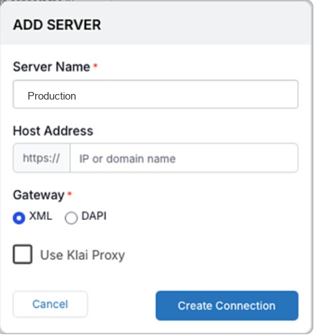

# Klai Server Proxy

::: warning
The Klai Server Proxy is deprecated and will be removed on January 10, 2027. New server connections should use your FileMaker server’s own host and the egress addresses on the [Firewalls](../security/security.md) page.
:::

## What to use instead

Klai Studio connects to FileMaker from a fixed address in each data center. Allow those addresses on your firewall, and point **Host Address** at the FileMaker server’s own IP address or domain name. Leave **Use Klai Proxy** unchecked.

## Servers that still use the proxy

Until January 10, 2027, a server with **Use Klai Proxy** checked is still reached through the proxy. Inbound HTTPS to that FileMaker server comes from `54.215.158.200` on port `443`.

That address is not one of the egress addresses. Keep it allowed only while the proxy is still turned on for that server.

Before the removal date:

1. Allow all six addresses on the [Firewalls](../security/security.md) page.
2. Open the server in the Klai editor.
3. Set **Host Address** to the FileMaker server’s own IP address or domain name. The field already includes the `https://` prefix.
4. Uncheck **Use Klai Proxy**.
5. Test the connection.

<figure><figcaption>Uncheck Use Klai Proxy, and keep the FileMaker server’s own host in Host Address.</figcaption></figure>

If **Host Address** was set by pasting the proxy URL, replace that URL with the FileMaker server’s own host and uncheck **Use Klai Proxy**.
