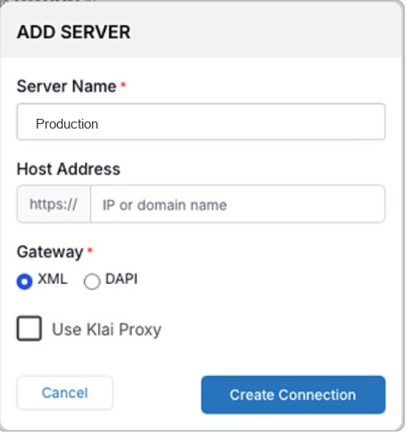

# Klai Server Proxy

### Overview

The Klai Proxy can be used to provide a single known IP address to access a given database server. This allows IT professionals to tightly configure access control to their internal network. The current proxy IP is located in North America.

#### PROS

Dev Ops technicians can whitelist only one IP address from the Klai Studio Cloud servers.

#### CONS

Some latency is added depending on your geographic location, this is generally small.

#### Specifications

Fixed IP Address is: <mark style="color:blue;">**`54.215.158.200`**</mark>

Port: <mark style="color:blue;">**`443`**</mark>

Proxy location: **AWS Data Center in Northern California. `US-WEST-1`**

#### Configuring

In the Klai editor, add a server and check **Use Klai Proxy**. **Host Address** is the FileMaker server’s own IP address or domain name.

The checkbox routes that server through the Klai proxy. Traffic to your FileMaker server then comes from the fixed proxy IP above, so the firewall only needs to allow that address.

1. Open **Add Server**.
2. Enter a **Server Name**.
3. Enter the FileMaker server’s IP address or domain name in **Host Address**. The field already includes the `https://` prefix.
4. Choose the gateway: **XML** or **DAPI**.
5. Check **Use Klai Proxy**.
6. Click **Create Connection**.

Ask your network team to allow inbound HTTPS from `54.215.158.200` on port `443`.

<figure><figcaption>Check Use Klai Proxy, and enter the FileMaker server’s own host.</figcaption></figure>

Servers that were pointed at the proxy by pasting the proxy URL into **Host Address** can be switched over the same way: use the FileMaker server’s own host, and check **Use Klai Proxy**.

#### Testing Connection

To confirm the proxy can reach your FileMaker server, open this URL in a browser. Replace `YOUR.SERVER.DOMAIN` with the server’s domain name:

`https://4yt4c3i6n7tndqe6732fsbgxhq0gsaim.lambda-url.us-west-1.on.aws/YOUR.SERVER.DOMAIN`

This URL is only for that check. In the editor, keep the real host in **Host Address** and use the **Use Klai Proxy** checkbox.

If the proxy is working, you should reach the same kind of response page your FileMaker server would normally return for a direct browser request.

If it does not work, check:

- the server domain name is correct
- your FileMaker server is reachable on the expected web endpoint
- your network rules allow the published proxy IP
- the domain is included at the end of the proxy URL

Example response:

```html
<!DOCTYPE HTML PUBLIC "-//W3C//DTD HTML 4.01 //EN" "http://www.w3.org/TR/html4/loose.dtd">
<html>
<head>
    <title>FileMaker Website</title>
        <style type="text/css">
        .centered {
             display: block;
             margin-left: auto;
             margin-right: auto;
             text-align: center;
             vertical-align: middle;
        }
        </style>
        <link rel="icon" type="image/x-icon" href="/favicon.ico" />
</head>

<body>
    <h1  class="centered" >FileMaker Database Server Website</h1>
    
    
</body>

</html>
```
